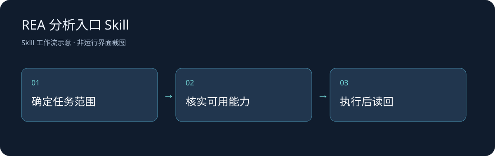

# REA 分析入口 Skill

将已发布程序、应用包与明确要求的行为取证引导到REA官方能力；源码阅读继续使用常规工具。

## 安装与使用

这是支持`SKILL.md`的AI Agent宿主使用的技能包，技术栈为Markdown。将完整目录以`rea-local`为名放入宿主指定的用户技能目录，保持相对结构并按宿主方式重新加载。模型、文件权限和实际工具由宿主提供。

调用示例：

> 用 $rea-local 只读我指定的应用包，先明确需要证明的问题和当前可用的静态分析能力。

## 范围与文件

只分发本地编写的入口说明，不包含REA、分析引擎或待分析程序。官方Skill、MCP/CLI和分析引擎需另行配置；不能据此宣称某种反编译能力已连接。

`SKILL.md`保留完整定制工作流，`docs/workflow.svg`展示步骤，`CHANGELOG.md`记录归档变化。第三方工具、个人配置、账号、原始用户文件和运行输出不在包内。自有文字采用[MIT](LICENSE)，不会重新许可上游软件。

## 验证与后续

2026-10-26：核对原文完整性，替换机器专属路径，检查Markdown结构与隐私。没有执行新的完整宿主会话、文件转换、工具安装或程序分析，图示也不代表这些功能已经实测。后续应针对实际宿主与具体文件补充可复现案例。
